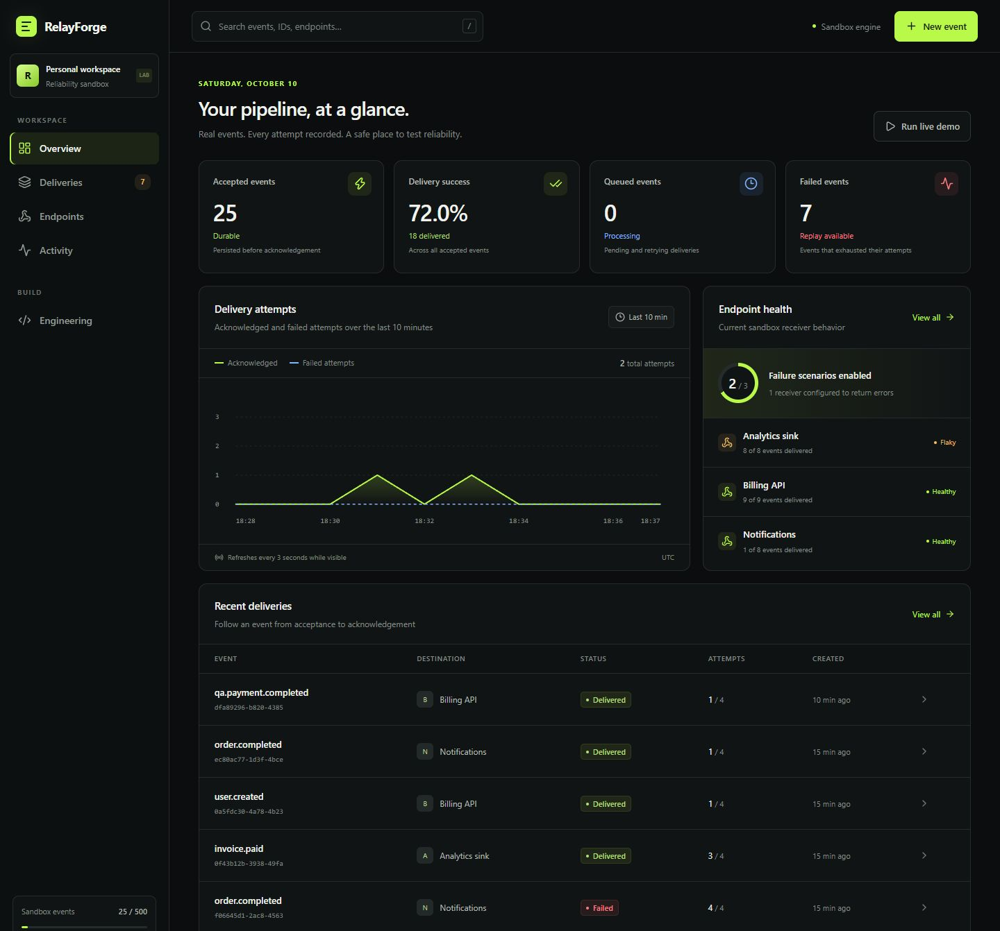

# RelayForge

**A webhook reliability lab that makes failure, retries, and recovery visible.**

Send an event, make a receiver fail, inspect every attempt, and replay a delivery after recovery. RelayForge combines an animated operations dashboard with a persistent queue, idempotency, signed payloads, and explicit failure states.

This is a working portfolio MVP. Its receivers are controlled demonstrations, and its queue advances through requests while the dashboard is open. It makes reliability behavior inspectable without claiming to be a production delivery service.

[Architecture](docs/ARCHITECTURE.md) · [Validation](docs/VALIDATION.md) · [Interview guide](docs/INTERVIEW-GUIDE.md) · [Security](docs/SECURITY.md) · [Roadmap](docs/ROADMAP.md)



[Account screen](docs/login-preview.jpg) · [Mobile dashboard](docs/mobile-preview.jpg)

## Try the failure path

1. Open the dashboard and run the demo scenario.
2. Switch a receiver between healthy, flaky, failing, and timeout behavior.
3. Inspect a delivery's payload and attempt history as retries progress.
4. Restore a failing receiver, then replay its dead delivery.
5. Compare accepted events, duplicate submissions, and receiver business effects.

The project gives you concrete questions to investigate: what happens when two processors compete, an attempt is interrupted, or the same event arrives again?

## Engineering decisions

| Concern               | Implemented approach                                                                 | Boundary                                                                    |
| --------------------- | ------------------------------------------------------------------------------------ | --------------------------------------------------------------------------- |
| Durable state         | SQLite stores deliveries and attempts                                                | Processing requires requests; there is no autonomous daemon                 |
| Duplicate submissions | A unique key scoped to tenant and endpoint identifies an accepted event              | A reused key with a different payload or event type returns `409`           |
| Competing processors  | Atomic lease claims and token-checked completion                                     | An expired lease can lead to another attempt                                |
| Recovery              | Four automatic attempts, backoff with jitter, dead state, and manual replay          | Receiver recovery is not guaranteed                                         |
| Receiver effects      | A unique event constraint deduplicates demo effects                                  | Real receivers need their own transactional idempotency                     |
| Payload authenticity  | HMAC-SHA256 with a timestamp and five-minute validity window                         | The processor uses an in-process receiver, not an external HTTP call        |
| Tenant isolation      | Application-owned accounts and server-side sessions scope data and dashboard actions | Authentication and recovery policies need review before a public deployment |
| Destination safety    | Only built-in receiver destinations are accepted                                     | Arbitrary external webhook URLs are unsupported                             |

Replay retains the event ID, payload, and idempotency key. It resets the current attempt budget while preserving attempt history. Neither idempotency nor leasing provides exactly-once network delivery.

## Stack

- **TypeScript** across browser, API contracts, and server logic.
- **React 19, Motion, and Tailwind CSS** for the interactive dashboard.
- **Next.js and Node.js 24** for the application runtime.
- **SQLite and Drizzle** for persistent state and migrations.
- **Node's test runner** for focused reliability checks.

One language keeps the frontend and backend approachable. Runtime validation, database constraints, and server-owned authorization still matter: TypeScript alone does not validate network requests or enforce access control.

## Run locally

Use **Node.js 24** and npm:

```sh
npm ci
npm run db:migrate
npm run dev
```

Open `http://localhost:3000`, create an account, and sign in. Registration signs you in immediately. Passwords must contain 12–128 characters. The application owns its email/password authentication and session handling. Each account has an isolated workspace.

Development uses Next.js's webpack mode after repeated reloads were observed in the Windows checkout during local verification. Production uses the standard `next build` command.

The migration command applies the committed SQLite migrations. The database defaults to `.data/relayforge.sqlite`; set `DATABASE_PATH` to change its location. The application also applies pending migrations when the database opens. Keep the database on writable, persistent storage when deploying so account and delivery history survive restarts.

To run the production build:

```sh
npm run build
npm start
```

Deploy to a Node.js environment with persistent disk storage and HTTPS. The project does not require a particular hosting provider or an external identity account.

## Verify the work

```sh
npm run lint
npm run typecheck
npm test
npm run build
```

CI runs these commands and a production dependency audit after a clean dependency install. The [validation record](docs/VALIDATION.md) contains the dated check results and known full-audit findings. For behavior beyond unit tests, run the demo, observe scheduled retries, replay after receiver recovery, and refresh to confirm that delivery history persists. Closing the tab preserves records but stops dashboard-driven processing.

With the development server running, use a second terminal for the real HTTP smoke check:

```sh
npm run smoke
```

It checks authentication, same-origin mutation protection, a persisted event and attempt, duplicate submission, and an idempotency conflict. It only accepts loopback URLs and creates its own test account. Each run adds one event to that account's workspace.

No throughput, availability, or latency benchmark is claimed. Dashboard durations describe controlled receiver attempts; they do not measure external network performance. Each workspace accepts up to 500 events. The overview snapshot returns the latest 100 deliveries; the delivery-history API pages through the workspace's full accepted history with server-side search, status, and endpoint filters.

## Code map

| Path                     | Responsibility                                                                        |
| ------------------------ | ------------------------------------------------------------------------------------- |
| `app/`                   | Dashboard and HTTP route entry points                                                 |
| `lib/contracts.ts`       | Shared actions, snapshot, paginated delivery-history, and detail types                |
| `lib/server/auth.ts`     | Credential validation, password hashing, session lifecycle, and authentication limits |
| `lib/server/database.ts` | Native SQLite adapter, transactional batches, and migration tracking                  |
| `lib/server/service.ts`  | Acceptance, leases, processing, receiver effects, and snapshots                       |
| `lib/server/domain.ts`   | Retry policy, canonical JSON, hashing, and signatures                                 |
| `lib/server/http.ts`     | Runtime validation, request bounds, and API errors                                    |
| `db/` and `drizzle/`     | Database schema and committed migrations                                              |
| `tests/`                 | Reproducible reliability checks                                                       |
| `docs/`                  | Architecture, demo narrative, and next milestones                                     |

Start with [the architecture](docs/ARCHITECTURE.md) to follow acceptance, claim, receiver handling, and completion. The [interview guide](docs/INTERVIEW-GUIDE.md) covers the tradeoffs worth explaining before adding features.

## Design references

The design draws on [Stripe's webhook guidance](https://docs.stripe.com/webhooks), including duplicate events and signature verification, and [AWS's discussion of safe retries with idempotent APIs](https://aws.amazon.com/builders-library/making-retries-safe-with-idempotent-APIs/). RelayForge demonstrates these ideas in a controlled environment; it does not implement either provider's service or protocol.
