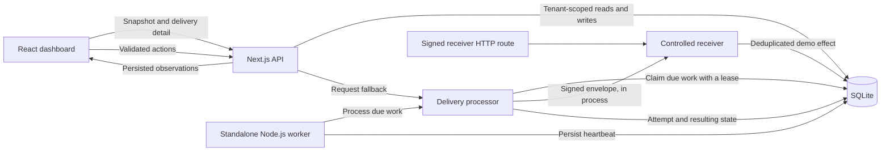
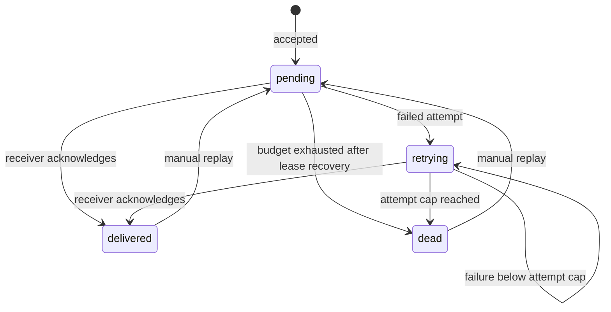

# Architecture

RelayForge makes webhook recovery visible through a full stack application. Its persistent queue can be processed by a standalone worker, with dashboard requests as a fallback. It is designed for an inspectable demo and engineering discussion.

## Data flow

These are logical boundaries sharing one database and delivery implementation. The web application and worker run in separate processes. In either process, the processor calls `RelayService.receive()` directly; it does not send outbound HTTP requests. A signed HTTP receiver route reuses the same logic. This structure exercises signature verification and delivery state without claiming actual external delivery.

## HTTP and shared contracts

| Route                     | Purpose                                                           | Authentication                                 |
| ------------------------- | ----------------------------------------------------------------- | ---------------------------------------------- |
| `POST /api/auth/register` | Create an email/password account and a session                    | Same-origin checks and validated credentials   |
| `POST /api/auth/login`    | Verify credentials and create a session                           | Same-origin checks and validated credentials   |
| `POST /api/auth/logout`   | Revoke the current session                                        | Session and same-origin checks                 |
| `GET /api/snapshot`       | Read persisted dashboard state; no mutation                       | Application session                            |
| `GET /api/deliveries`     | Search and page through tenant-owned delivery history             | Application session                            |
| `POST /api/action`        | Initialize, send, demo, set receiver mode, replay, pause, or pump | Application session and same-origin checks     |
| `GET /api/deliveries/:id` | Read one tenant-owned delivery and its attempts                   | Application session                            |
| `POST /api/receiver/:id`  | Verify a signed envelope and invoke a controlled receiver         | HMAC; no browser session required by the route |

Accounts and sessions belong to the application. A browser request establishes identity through its session cookie; client-supplied identity headers and owner IDs are not trusted.

The `/login` page supports account creation and sign-in. The server validates emails and passwords, including the 12–128 character password bound. The database defaults to `.data/relayforge.sqlite`; `DATABASE_PATH` can select a persistent deployment path. Committed migrations apply on database initialization and can also be run explicitly through `npm run db:migrate`.

Passwords use salted scrypt hashing. Sessions contain a random opaque token; only its SHA-256 hash is stored in the database. The session expires after seven days. Its cookie is HttpOnly and SameSite=Lax, with Secure enabled in production. Sign-out revokes the stored session. Authentication attempts are bounded by persistent ten-minute counters: ten per normalized email and 100 across the application.

`lib/contracts.ts` defines `Action`, `Snapshot`, `DeliveryPage`, `DeliveryDetail`, and the visible states. The server validates incoming actions with Zod because TypeScript types do not constrain arbitrary request JSON. The snapshot includes the authenticated account's ID and email, describes the observed processor mode using the worker heartbeat, and exposes the retry cap, workspace event limit, and snapshot limit. Signing secrets, password hashes, and session tokens are excluded.

The delivery-history endpoint accepts `page` (1–500, default 1), `pageSize` (1–50, default 20), `search` (up to 100 characters), `status` (`all`, `pending`, `retrying`, `delivered`, or `dead`), and `endpointId` (`all` or an endpoint ID). Unknown or duplicated parameters and invalid values return `400`. Search matches literal text in event IDs, event types, and endpoint names; `%` and `_` have no wildcard meaning. All query conditions remain scoped to the authenticated account.

The history response returns deliveries, the total matching count, the requested page and page size, and the number of pages. Count and page rows are read in one database batch. Ordering uses creation time and insertion order to resolve equal timestamps. Each delivery includes its latest recorded attempt's status code, measured duration, error, and timestamps, or `null` when it has no attempt. An unfinished attempt has a null finish time and duration; it does not imply a timeout response. A recovered lease can have a finish time without an HTTP result, and its measured duration remains null.

Each endpoint summary includes `lastDurationMs` from its latest finished attempt with a recorded HTTP response across the full workspace history. The value is null if no measured response exists and is independent of the snapshot's latest-100 delivery window. Interrupted leases do not replace this measurement with a default zero.

## Delivery lifecycle

1. **Accept.** Validate the action and tenant-owned endpoint. Canonicalize the payload, hash the payload and event type, and insert under a unique `(owner, endpoint_id, idempotency_key)` constraint. A matching duplicate returns the original event; a conflicting key returns `409`.
2. **Claim.** A pump recovers expired leases, finds up to 12 due deliveries, then conditionally updates each to acquire a 15-second lease. The claim increments the current attempt budget and creates an attempt record in a database batch.
3. **Attempt.** HMAC-sign the canonical envelope and call the controlled receiver. The receiver verifies signature, timestamp, event ownership, and immutable payload before applying its configured behavior.
4. **Record.** Persist the attempt result and transition to delivered, retrying, or dead. Completion writes require the current lease token so a stale processor cannot overwrite a newer claim.
5. **Recover.** Manual replay accepts a completed or dead delivery, preserves its ID and payload, resets the current attempt budget, and retains historical attempt records.

Leasing is separate from visible status. A leased delivery can be pending or retrying. Attempt numbers represent the current replay cycle; retained history can contain the same number from earlier cycles. No replay-cycle identifier is modeled yet.

The standalone worker checks persisted due work independently of HTTP requests and invokes the same tenant-scoped processor as the API. When no recent worker heartbeat is observed, the dashboard continues requesting pump actions as a fallback. A snapshot read never advances processing. Pause preserves queued data and blocks new claims in either process; it does not cancel work already claimed.

## Standalone worker

`npm run worker` starts a Node.js 24 process using the application's native SQLite adapter, committed migrations, receiver behavior, and lease rules. Run it from the project directory with the same `DATABASE_PATH` as the web application. It does not need a browser, HTTP listener, or account session: local access to the database is the worker's authority. Its processing remains scoped to each stored workspace, and the HTTP APIs continue deriving user identity from authenticated sessions.

`lib/server/worker.ts` owns processing passes and lifecycle handling; `scripts/worker.mjs` loads local environment configuration and starts the process. The worker writes its instance UUID, start time, and last observation time to the `worker_heartbeats` table. Snapshots expose `system.worker.activeWorkers` and `lastHeartbeatAt`, with processor mode `worker` or `request-driven`. An observation older than ten seconds is stale, so the dashboard switches to request-driven fallback. A recent heartbeat establishes that the worker wrote to this database recently. It does not prove that all queued work is progressing, the next retry will start at an exact time, or the receiver is healthy. Multiple processors still rely on conditional leases and completion tokens, rather than the heartbeat, for claim protection.

SIGINT and SIGTERM stop scheduling new passes and wait for an ongoing pump before the database closes. Forced process termination may leave a lease and unfinished attempt; a later worker or request pump recovers the expired lease. Run the web application and worker as separately supervised processes when deploying. Their storage and migrations must remain available, and their relative database paths must resolve to the same file.

## Policy and demo receivers

| Policy                | Current behavior                                          |
| --------------------- | --------------------------------------------------------- |
| Automatic attempt cap | Four attempts per cycle                                   |
| Retry delay           | Exponential base starting at one second, with ±20% jitter |
| Lease                 | 15 seconds; expiry consumes the interrupted attempt       |
| Healthy receiver      | Acknowledges and deduplicates its demo effect             |
| Flaky receiver        | Returns `503` for the first two attempts, then succeeds   |
| Failing receiver      | Returns `500` until its mode changes                      |
| Timeout receiver      | Waits 250 ms and reports a controlled `504`               |
| Workspace capacity    | 500 accepted events                                       |

The timeout mode is a simulated outcome, not proof of cancellation of a slow external HTTP request. The current policy retries any unsuccessful controlled receiver response until the cap; a production retry taxonomy would distinguish terminal and transient failures.

## Two kinds of idempotency

Producer deduplication and receiver effect deduplication solve different problems.

At acceptance, the unique key scoped to tenant and endpoint prevents repeated logical submissions from creating additional queue records. Canonical JSON keeps reordered object keys from changing the hash. If a key is reused with a different event type or payload, the server rejects the conflict.

At the receiver, a unique `(owner, event_id)` constraint prevents another demo effect from being inserted for the same event. This stays effective when a delivered event is replayed with its original identity.

Consider a real receiver that commits an effect and loses its acknowledgement. The sender cannot know whether the effect happened. Retrying can create another network attempt. Receiver idempotency can keep the business effect singular, but it cannot establish exactly-once network delivery. RelayForge currently uses an in-process receiver, so this network ambiguity is a design discussion and future integration-test case.

An external receiver would need to atomically commit its deduplication record and business change in its own database. A remote HTTP response and a sender database write cannot be treated as one transaction.

## Failure and concurrency

| Situation                         | Implemented behavior                                               | Remaining limit                                      |
| --------------------------------- | ------------------------------------------------------------------ | ---------------------------------------------------- |
| Same key is submitted again       | Return the accepted event and track the duplicate                  | Different payload or type is a conflict              |
| Two pumps target the same event   | Conditional update permits only one active lease claim             | Real concurrency deserves database integration tests |
| Processor stops before completion | Later pumping marks the interrupted attempt and recovers the lease | Recovery needs a later worker pass or request pump   |
| Stale processor tries to finish   | Completion requires its lease token                                | A lease does not stop all repeated receiver calls    |
| All automatic attempts fail       | Dead state exposes the event for inspection and replay             | Recovery is an operator decision                     |
| Dashboard is closed               | Stored queue state remains; a running worker can process due work  | Without a worker, progress waits for request pumping |

Persistence and autonomous execution are separate properties. Leases reduce overlapping work; they do not make network delivery exactly once.

## Security boundaries

- **Ownership:** the authenticated service derives ownership from the server-side session's user ID. Browser-supplied tenant IDs cannot select a workspace.
- **Authentication:** email/password accounts and opaque sessions are stored by the application. Authentication does not depend on external identity headers.
- **Mutation checks:** dashboard actions require same-origin requests, `application/json`, and strict action schemas. IDs, event types, modes, and payload structure are bounded.
- **Resource bounds:** request bodies are capped at 16 KiB, event payloads at 12 KiB, JSON depth at 24, and traversal at 2,000 nodes.
- **Destination restriction:** sends target built-in receiver IDs. No arbitrary user URL is fetched.
- **Signing:** HMAC-SHA256 covers `timestamp + "." + raw body`, with a five-minute timestamp window and server-owned signing secrets. Web Crypto verifies the signature.
- **Data access:** detail reads, replay, receiver changes, and snapshots use ownership checks. An opaque ID is not authorization.
- **Worker authority:** the local worker has direct database access and can process stored workspaces. Keep its database access and process configuration restricted; browser clients cannot select its ownership context.

Signing secrets are persisted in the demo database and are excluded from API responses. Secret encryption, rotation, and revocation are future work. HMAC does not replace tenant authorization, TLS, or effect deduplication.

## Runtime and observations

React and TypeScript keep the UI and contracts readable. Next.js runs the application on Node.js 24. SQLite provides persistent storage without a separate database service for the demo; Drizzle makes the schema and migration SQL visible. Deployments need a writable persistent database path and HTTPS.

The native SQLite adapter uses write-ahead logging, foreign-key enforcement, a five-second busy timeout, and immediate transactions for batches. Migration tracking records each SQL file's checksum and refuses a changed migration that has already been applied. Changing the database implementation therefore requires an explicit adapter with equivalent transaction and claim behavior.

The dashboard exposes attempts, duration, next retry time, activity, queue pause state, and aggregate delivery counts. Success rate uses current delivered events divided by total events. Average duration includes finished attempts with recorded status codes; it is not external network latency. The chart groups attempt outcomes by UTC minute over the recent ten-minute window. Snapshot reads return the latest 100 deliveries and 30 activity entries. The separate history endpoint can page and filter across all accepted events within the 500-event workspace limit.

This MVP does not claim unlimited scale. [The roadmap](ROADMAP.md) separates the standalone worker from further operational evidence, a Postgres adapter, and external delivery integration.
