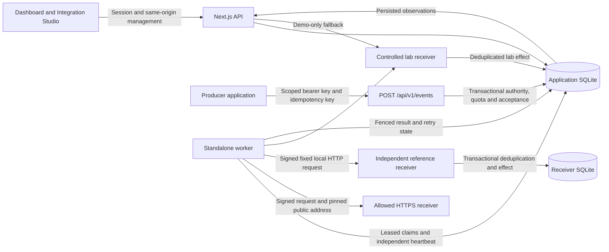
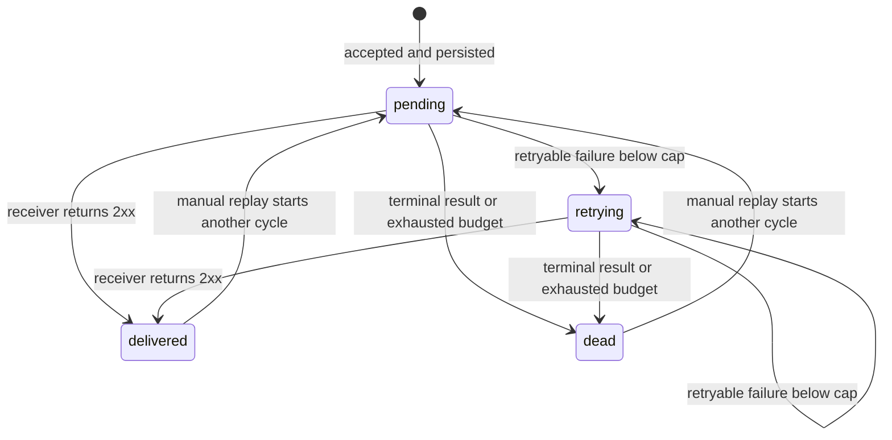

# Architecture

RelayForge 2.1 separates producer acceptance, delivery attempts, receiver acknowledgement, and business effects. A Next.js web application and standalone Node.js worker share a durable SQLite queue. Live network requests run only in the worker; browser request fallback processes controlled lab receivers. Delivery Insights reads aggregates directly from stored history without advancing the queue.

## Data flow

The reference receiver has its own database and per-connection verification configuration. It does not read the application database or encryption master key. HTTPS receivers operate outside RelayForge's storage boundary: a 2xx response proves acknowledgement, not a remote business effect.

## HTTP boundaries

| Route                                                      | Responsibility                                        | Authority                                     |
| ---------------------------------------------------------- | ----------------------------------------------------- | --------------------------------------------- |
| `POST /api/auth/register`, `/login`, `/logout`             | Account and session lifecycle                         | Validated credentials or session; same origin |
| `GET /api/snapshot`                                        | Persisted observations without queue progress         | Application session                           |
| `GET /api/insights`                                        | Windowed event/attempt aggregates and current queue   | Account-owned session; strict query filters   |
| `GET /api/deliveries`, `/api/deliveries/:id`               | Full history, filters, and event detail               | Account-owned session                         |
| `GET /api/connections`                                     | Connection metadata and operator capabilities         | Application session                           |
| `POST /api/connections`                                    | Create an immutable destination and signing key       | Session, same origin, strict JSON             |
| `PATCH /api/connections/:id`                               | Enable or disable using `expectedRevision`            | Account ownership, session, same origin       |
| `POST /api/connections/:id/rotate`                         | Rotate signing key with a revision guard              | Account ownership, session, same origin       |
| `POST /api/connections/:id/events`                         | Studio acceptance into the persistent queue           | Account ownership, session, same origin       |
| `GET /api/producer-keys`                                   | Public key metadata                                   | Application session                           |
| `POST /api/producer-keys`, `DELETE /api/producer-keys/:id` | Create a scoped token or revoke it                    | Account ownership, session, same origin       |
| `POST /api/v1/events`                                      | Producer acceptance                                   | Bearer key only; one connection per key       |
| `POST /api/action`                                         | Lab behavior, send, replay, pause, and demo-only pump | Session, same origin, strict JSON             |
| `POST /api/recovery/replay`                                | Up to 20 cycle-guarded dead deliveries                | Session, same origin, ownership               |
| `GET /api/security`, `POST /api/security`                  | Session inspection, revocation, password rotation     | Session; mutations require same origin        |
| `GET /api/audit`                                           | Complete delivery and security audit history          | Account-owned session                         |
| `POST /api/receiver/:id`                                   | Signed controlled lab envelope                        | HMAC; demo transport only                     |

Session identity comes from an opaque cookie, not an owner ID or identity header submitted by the browser. The producer route has a separate bearer boundary and derives both owner and connection from its key. It cannot use a browser session as a substitute.

Requests are limited to 16 KiB, payloads to 12 KiB, JSON depth to 24, and traversal to 2,000 nodes. History queries reject unknown or repeated parameters, bound pagination and search, and scope count and rows to one account. API errors include readable `error`, stable `code`, and server-generated `requestId`; unexpected failures do not return exception details or submitted data.

## Acceptance and delivery

1. **Accept:** validate the event and enabled owned connection; canonicalize payload data and insert under unique `(owner, endpoint_id, idempotency_key)`. Matching content returns the original event; changed event type or payload returns `409`.
2. **Authorize producer acceptance:** recheck hashed bearer key, expiry, revocation, scope, enabled connection, and persistent minute quotas inside the same immediate transaction as enqueue. Producer data cannot choose another owner or connection.
3. **Admit:** the worker has four processing lanes. A lane is available before an event is claimed. Each workspace gets a turn in successive rounds, bounded to 100 selected workspaces and 12 rounds per tick.
4. **Prepare and claim:** live configuration and signing-key decryption must succeed before consuming an attempt. Disabled connections remain queued. A conditional update acquires a 15-second lease, increments the current budget, and records the attempt and connection revision.
5. **Send:** demo work calls the controlled receiver; live work signs a stable envelope and performs a real bounded HTTP request. The reference transport uses its fixed local address; HTTPS resolves and pins validated public addresses.
6. **Complete:** attempt observations, activity, and delivery state are written under the matching lease token. A stale worker cannot overwrite a newer claim.
7. **Recover:** replay preserves event ID, payload, and producer idempotency key. It increments the cycle, resets its four-attempt budget, and keeps all earlier attempts.

Leasing is separate from visible status. An expired lease consumes its interrupted attempt; a subsequent worker marks the interruption and queues another eligible attempt or dead state. Old attempts whose cycle is null stay in **Legacy history**; migrations do not infer cycle boundaries.

## Live transport

HTTPS destinations are immutable and limited to exact operator-configured DNS hostnames. Allowed URLs use HTTPS/443, contain no credentials, query, fragment, or IP literal, and are at most 2,048 characters. Hostnames are normalized and wildcards are unsupported. Changing a destination requires another connection.

Every attempt resolves A and AAAA records. All returned addresses must be public; mixed public/private answers are blocked. IPv4-mapped IPv6 is classified as IPv4, IPv6 special ranges are rejected conservatively, and zone identifiers are invalid. The request pins one validated address using a custom lookup while retaining the original hostname for Host, SNI, and normal TLS certificate verification. The transport creates its own direct request without proxy inheritance or shared-agent address reuse and does not follow redirects.

A five-second total deadline covers DNS, connection, TLS, and response headers. Expiry cancels the resolver and destroys the request. Response headers are capped at 8 KiB, and response bodies are discarded. HTTP results retain their actual status; DNS, TLS, deadline, and network failures have a null status and a bounded failure category.

| Result                                                | Policy                                    |
| ----------------------------------------------------- | ----------------------------------------- |
| 2xx                                                   | Acknowledged; visible delivered state     |
| Network/DNS/TLS/deadline failure                      | Retry below the four-attempt cap          |
| HTTP 408, 429, 5xx                                    | Retry below the cap                       |
| Other 3xx/4xx                                         | Terminal dead state                       |
| Blocked destination or oversized response headers     | Terminal failure                          |
| Missing/incorrect signing key or disabled live policy | Leave queued without consuming an attempt |

Retries use the existing exponential base beginning at one second with ±20% jitter. A valid `Retry-After` on HTTP 429 or 503 can extend the schedule, up to 24 hours. Invalid or oversized values do not replace the policy.

## Keys and independent receiver

Each live connection has random 32-byte HMAC signing material. AES-256-GCM encrypts it using a protected 32-byte master file outside the checkout. Authenticated associated data binds ciphertext to owner, connection, and key ID. There is no plaintext fallback. Creation and rotation reveal the signing secret once; regular connection metadata contains key IDs and timestamps only.

Rotation uses the connection revision guard and commits key changes with audit state. The previous key stays valid for 24 hours and live attempts carry both signatures during that interval. A second rotation cannot start while an earlier grace period remains active.

Producer keys are separately generated random tokens, stored as SHA-256 hashes with a public prefix. They have `events:write` scope for one enabled HTTPS/reference connection, expire in 1–90 days (default 90), and are capped at ten active keys per workspace. Persistent fixed-minute quotas allow 60 admitted requests per key and 240 per owner; duplicate submissions also use quota.

The reference receiver verifies the timestamped HMAC and matching event/cycle headers, checks immutable content, and commits an effect and receipt in its own immediate transaction. Its uniqueness key is `(endpoint_id, event_id)`. In `lose-first-ack` mode, a newly committed effect is followed by a dropped socket; the sender records a network failure and retries the same event. The retry acknowledges the existing effect. Receiver storage supplies the evidence for one effect; the application's dashboard does not independently count that remote database.

The full wire format and setup are in [Integration setup](INTEGRATIONS.md).

## Recovery, observation, and navigation

Recovery queries complete dead-delivery history. Bulk replay accepts 1–20 unique `{eventId, expectedCycle}` selections, reports replayed/skipped results, and returns a fresh snapshot. Eligibility is checked inside the write transaction: ownership, dead status, cycle match, no active lease, and standard receiver. Foreign and missing IDs have the same generic skip result. All successful state/audit writes commit together or roll back; pause prevents new claims after replay.

Recovery Lab persists one current scenario's event and receiver references per workspace. Stages come from delivery, repair, and effect state. Repeated start does not produce another active event; rerunning a completed scenario preserves its earlier event. The guide exclusively manages its receiver settings and replay controls.

The worker publishes a heartbeat every two seconds while work is running independently of slow network requests. Snapshots consider observations newer than ten seconds active. A heartbeat establishes recent access to this database, without proving receiver health or a delivery deadline. Browser fallback never sends live network requests.

The generic snapshot keeps the latest 100 deliveries and 30 activities. **Live** and **Lab** scope summaries query their own authoritative totals, chart, and eight recent deliveries across full persisted history. The ten-minute chart groups finished attempt outcomes by UTC minute. Average duration includes measured HTTP/network outcomes and excludes unfinished or unmeasured lease interruptions. Live metrics never count controlled lab receiver effects.

Dashboard URLs preserve view, scope, list filters, pagination, and inspected event ID. Live is the default overview; `scope=lab` restores the Lab view. Existing `view=endpoints` links now open Connections. The Studio connection uses `view=studio&endpoint=…`; Insights uses `view=insights` with optional `scope`, `window`, and `endpoint`. Safe sign-in return paths and copied event links carry navigation state, not authorization. Palette event searches use the account-owned full-history API, bound results, and cancel stale searches. Insights is also a palette destination.

## Delivery Insights

`InsightsService` runs account-owned SQL aggregates in one adapter transaction. It does not derive results from the snapshot's 100 deliveries, load event payloads, pump queued work, or contact receivers. The response contains bounded aggregates, connection display metadata, and twelve timeline buckets. Authentication retains the existing session lifecycle.

`GET /api/insights` accepts only `scope=live|lab`, `window=1h|24h|7d`, and `endpointId=all|<owned-id>`; defaults are Live, 24 hours, and all connections. Repeated or unknown query parameters are rejected. Foreign and missing connection IDs return the same generic `404`; an owned connection outside the selected transport scope yields empty observations.

Event counts select deliveries accepted in the inclusive `[since, now]` interval and report their **current** status. Attempt counts instead select attempts started in that interval, including retries and replays of events accepted earlier. They can exceed event counts, and replay can change a cohort's current acknowledged count while its earlier failed attempts remain recorded.

All finished attempts contribute to `completed`: acknowledged HTTP outcomes, measured failures, and finished interruptions without a known result. Thus `total = completed + inFlight` and `completed = acknowledged + failed + unmeasuredInterrupted`. Measured samples require a finished attempt and an HTTP status or recorded failure code. Unfinished and unmeasured historical interruptions do not enter latency or outcome breakdowns. A recorded zero duration is valid; missing samples produce null percentiles. SQLite calculates p50/p95 by nearest rank, without averaging the middle values. HTTP status null remains distinct from a measured HTTP response, and failure categories expose a fixed vocabulary rather than stored error text.

Twelve equal UTC timeline buckets group accepted events and attempt outcomes by their respective start times. Intermediate buckets exclude their end boundary; the final bucket includes `now`. Queue observations use **all ages** within the selected account, scope, and connection. Due counts require an enabled connection, remaining attempt budget, a due schedule, and no lease; pause is reported separately. These counts precede worker configuration, signing, and destination checks and do not establish processing readiness.

See the [Insights guide](INSIGHTS.md) for interpretation, navigation examples, and measurement limits.

## Storage and operations

SQLite uses WAL, foreign keys, a five-second busy timeout, and `BEGIN IMMEDIATE` transactional batches. Committed migration checksums prevent silently changing an already-applied migration. The additive live migration classifies existing endpoints as demo and preserves accounts, events, cycles, and attempts.

Web and worker run separately, need the same writable persistent database and live configuration, and should be restarted together after a migration/configuration update. Back up the database before migration; preserve the protected master key separately. Graceful worker shutdown waits for current claims. Forced termination relies on lease expiry and another worker pass.

The project remains one SQLite deployment with 500 accepted events per workspace. Four live calls are a per-worker bound, not a distributed global limit. There is no production throughput/availability claim, automated retention, distributed quota service, or high-availability database adapter. See [Security](SECURITY.md) and the dated [Validation record](VALIDATION.md) for the implemented boundaries and actual check evidence.
