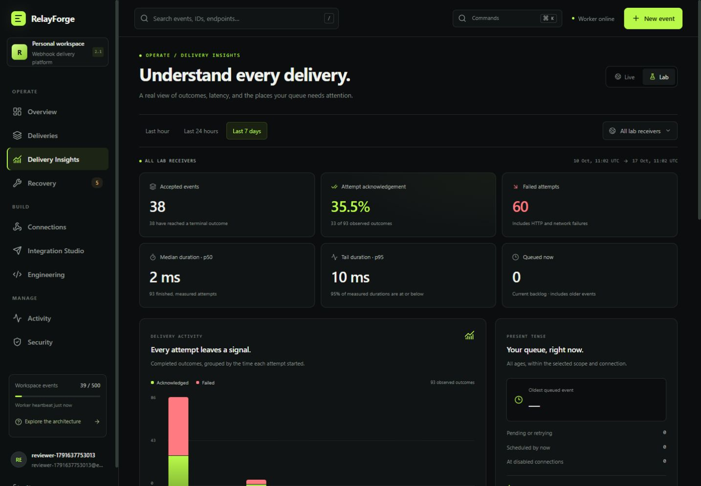

# Delivery Insights

Delivery Insights reads complete account-owned history for **Live** or **Lab**, the last **hour**, **24 hours**, or **seven days**, and optionally one connection. It reports recorded event outcomes, attempts, latency, HTTP and network failures, and the current queue. It does not depend on the generic snapshot's latest 100 deliveries.



[Mobile view](insights-mobile-preview.jpg) · [Architecture](ARCHITECTURE.md) · [Validation](VALIDATION.md)

## Open and share a view

Choose **Insights** in the navigation or the **Ctrl/Cmd + K** command palette. Scope, window, and connection filters are preserved in the dashboard URL. Browser Back and Forward restore those choices.

```text
/?view=insights
/?view=insights&scope=lab&window=1h
/?view=insights&window=7d&endpoint=YOUR_CONNECTION_ID
```

Defaults are Live, 24 hours, and all connections. Shared links still require a session belonging to the workspace. Connection rows can open delivery history for inspection; the delivery list has its own filters and is not limited to the Insights time window.

## Events and attempts answer different questions

**Events** selects records accepted in the inclusive `[since, now]` interval. Acknowledged, dead, and queued counts describe those records' **current** status. Replaying one of these events can change its current status without changing its acceptance time or increasing the accepted count.

**Attempts** selects records whose attempt started in that interval. This includes retries and replay cycles, even for events accepted before the window. One event may produce several attempts. Attempt acknowledgements and failures therefore have a different denominator from event outcomes.

For example, an event accepted yesterday may have four failed attempts, then one successful replay today. A last-hour view can show no newly accepted event, one acknowledged attempt, and the existing event in neither of that window's event-cohort counts. Its old failures remain visible when their attempt times fall inside a wider window.

Completed attempts include known acknowledgements, known failures, and finished interruptions with no measured result:

```text
total = completed + inFlight
completed = acknowledged + failed + unmeasuredInterrupted
```

An HTTP 2xx means the receiver **acknowledged** the request. Insights does not verify an external receiver's business effect or establish an exactly-once delivery guarantee.

## Latency and outcome breakdowns

Latency samples require a finished attempt with an HTTP status or a recorded failure code. Unfinished attempts and historical interruptions without either result are excluded. A measured `0 ms` remains a valid sample. With no samples, p50, p95, and maximum are null and the UI shows an empty value.

Percentiles use **nearest rank**: sort the samples and select rank `ceil(percentile × sample count)`. For durations `10, 20, 30, 40 ms`, p50 is `20 ms` and p95 is `40 ms`. This is not an average or an interpolated median. Connection p95 uses the same definition.

HTTP counts retain their actual status codes. A null status represents a measured failure without an HTTP response, such as DNS, TLS, timeout, or network failure. The failure breakdown groups HTTP families and a fixed set of network/policy categories; unknown recorded categories become **Unclassified failure**. Raw exception text and response bodies are not returned.

Live durations cover an attempted request through response headers or failure. Lab durations measure the controlled in-process receiver. Neither describes remote application processing time, production capacity, or a benchmark.

## Timeline and queue

The selected interval is split into **twelve equal UTC buckets**. Accepted counts use event acceptance time; acknowledged and failed counts use attempt start time. Bucket starts are inclusive and intermediate ends are exclusive. The final bucket includes the interval's `now` boundary. An expandable table provides the exact counts behind the chart.

The queue panel uses **all record ages**, filtered by the selected scope and connection. Its total includes pending and retrying events; oldest age comes from the oldest accepted queued event. Disabled connections are counted separately.

**Due** counts queued events with an enabled connection, remaining attempt budget, a due schedule, and no lease. It is evaluated before pause and worker configuration or destination checks. A paused workspace can therefore have due events. A positive count does not prove that a worker is running, signing material is usable, an operator policy allows delivery, or the receiver is reachable.

Reading Insights does not enqueue or replay events, create attempts or audit activity, advance the queue, or contact receivers. Session authentication retains its normal expiry and last-seen behavior.

## API and privacy

```http
GET /api/insights?scope=live&window=24h&endpointId=all
```

The API accepts only these query parameters:

| Parameter    | Values                          | Default |
| ------------ | ------------------------------- | ------- |
| `scope`      | `live`, `lab`                   | `live`  |
| `window`     | `1h`, `24h`, `7d`               | `24h`   |
| `endpointId` | `all` or an owned connection ID | `all`   |

Unknown or repeated parameters return `400`. Missing and foreign connection IDs return the same generic `404`; an owned connection outside the selected scope returns empty observations. Authentication requires an application session, and responses use `Cache-Control: no-store`.

Results contain aggregates and connection display metadata. They exclude event payloads, idempotency keys, raw errors, signing material, producer tokens, and stored credential hashes. The server generates the response timestamp; a subsequent refresh can change outcomes as workers complete or operators replay events.

See [Validation](VALIDATION.md) for the checks actually executed for this release.
