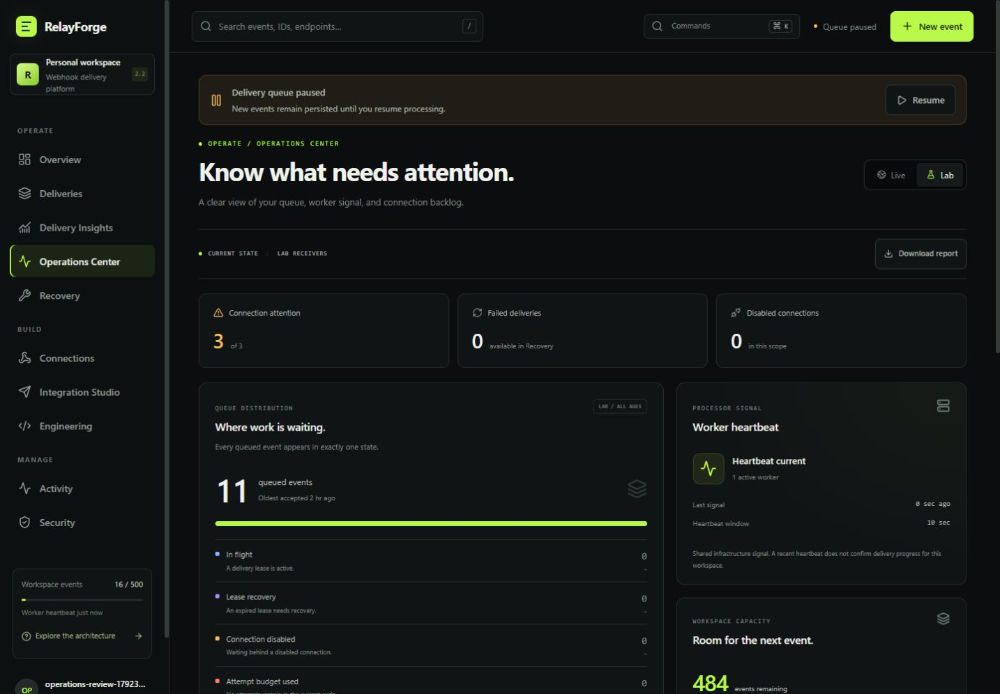

# Operations Center

Operations Center brings the current queue, worker heartbeat, workspace pause, connection attention, and remaining event capacity into one read-only screen. It uses complete account-owned history across **all stored ages**, independently of the generic snapshot's latest 100 deliveries.



[Mobile view](operations-mobile-preview.jpg) · [Architecture](ARCHITECTURE.md) · [Validation](VALIDATION.md)

## Open a scoped view

Choose **Operations Center** in the navigation or the **Ctrl/Cmd + K** command palette. The URL preserves the chosen Live or Lab scope, including browser Back and Forward navigation:

```text
/?view=operations
/?view=operations&scope=lab
```

Live is the default. Links require an authenticated session for the owning workspace. Operations describes the present state; use **Insights** for time-window observations and **Deliveries** or **Recovery** to inspect event history or review a replay.

Reading the report does not pump the queue, create attempts or audit activity, change connection settings, replay an event, or contact a receiver. Normal session expiry and last-seen handling still apply.

## Interpret the queue

The queue includes pending and retrying events within the selected scope. Every queued event appears in exactly one bucket, in this order of precedence:

| Bucket              | Meaning                                                                                       |
| ------------------- | --------------------------------------------------------------------------------------------- |
| In flight           | A claimed event has a lease that has not yet expired.                                         |
| Lease recovery      | A claimed event's lease has expired. A worker, or Lab request fallback, can recover it.       |
| Disabled connection | No lease takes precedence, and the connection is disabled.                                    |
| Budget exhausted    | The connection is enabled, but the current cycle has used its four attempts.                  |
| Scheduled           | An enabled event with remaining budget has a future next-attempt time.                        |
| Due                 | An enabled event with remaining budget has a next-attempt time at or before the report clock. |
| Needs inspection    | Remaining queue metadata, including missing schedules or an incomplete lease deadline.        |

The seven counts sum to the queue total. Their oldest timestamps refer to event acceptance time, which remains unchanged on retries or replay. Lease, schedule, and worker observations use the server clock at report time; refresh can change a classification.

**Pause is separate from these buckets.** A paused workspace can contain due or scheduled events, and an already claimed event can still finish. Resume allows future claims, subject to the existing worker and delivery checks.

Due is an observation about queue fields. It does not prove that signing keys can be decrypted, a hostname is permitted, DNS returns public addresses, a receiver is reachable, or a delivery will succeed. Operations performs none of those checks.

## Worker, capacity, and connections

A worker is **online** when its heartbeat is newer than ten seconds and no later than the report's server clock. The active count and latest heartbeat are shared deployment observations, not account-specific processing guarantees. A recently heartbeating worker may still encounter a configuration problem or receiver failure. Live delivery always needs a worker; Lab request fallback can process controlled events without making that worker online.

The Live queue warning appears when Live events are queued and no worker is fresh. A disabled Live connection can remain queued even while worker readiness passes. Stop or start worker processes through your normal supervisor; the screen does not launch processes.

Workspace capacity is **owner-wide**: all accepted Live and Lab events count against the existing 500-event limit. Delivered and dead events still occupy capacity because history is retained. Switching scope changes the queue and connection observations, not the accepted-event count or remaining allowance. This release adds no retention or deletion policy.

Connection rows show enabled state, queued and dead counts, and the oldest queued event. Attention flags highlight dead deliveries, exceptional queue states, and queued work waiting behind a disabled connection, workspace pause, or missing Live worker. An empty disabled connection is counted as disabled without needing attention. These observations do not report the health of an external receiver. Open the relevant connection, delivery list, or recovery view for the next action.

## Download diagnostics

The download saves the currently displayed report as JSON on your computer. It includes scope, report time, queue aggregates, worker freshness, pause and capacity, and connection names and IDs. Those names and identifiers make it **not anonymous**; review the file before sharing it.

The report excludes event payloads, idempotency keys, raw exception text, destination URLs, signing secrets, producer tokens, credential hashes, and worker identifiers. Downloading uses the existing report and does not test a connection or start delivery.

## Public liveness and readiness

Two public endpoints provide small responses suitable for process supervision:

| Endpoint                | Successful response           | Failure response                         | What it observes                                               |
| ----------------------- | ----------------------------- | ---------------------------------------- | -------------------------------------------------------------- |
| `GET /api/health/live`  | HTTP 200 `{"status":"alive"}` | An unavailable web process cannot answer | The web handler can respond; no database read                  |
| `GET /api/health/ready` | HTTP 200 `{"status":"ready"}` | HTTP 503 `{"status":"not_ready"}`        | Database access and at least one fresh shared-worker heartbeat |

Both disable caching, include a generated request ID header, and omit account counts, configuration, worker IDs, and exception details. Readiness requires a worker even for an empty deployment or Lab-only demonstration. A heartbeat exactly ten seconds old or later than the server clock is not fresh. A process that stops may remain fresh until its last heartbeat ages out; readiness observes the recorded heartbeat rather than inspecting operating-system processes.

Readiness does not inspect signing keys, operator hostname policy, remote DNS/TLS, connection enabled state, or receiver responses. It can pass while a receiver is failing. Configure deployment-specific alerts and process restarts separately.

Run the dependency-free command against a running application:

```sh
npm run health:check -- http://localhost:3000
```

The command exits with status zero only when both public probes pass. Use the correct deployed origin when checking a supervised environment. A successful local result is not a production availability or throughput claim.

## Authenticated report API

```http
GET /api/operations?scope=live
```

Only `scope=live|lab` is accepted; the default is Live. Unknown, empty, or repeated query parameters return `400`. An application session is required, and the account is derived from that session. Responses use `Cache-Control: no-store` and the existing request ID conventions.

The report reads full account-owned queue and connection state in a consistent transactional aggregate. It does not derive totals from the snapshot, return event bodies, access signing files, or perform network requests. Public health probes deliberately have a smaller response and do not expose the authenticated report.

See [Validation](VALIDATION.md) for the checks actually executed for this release, including isolated HTTP verification and browser review.
